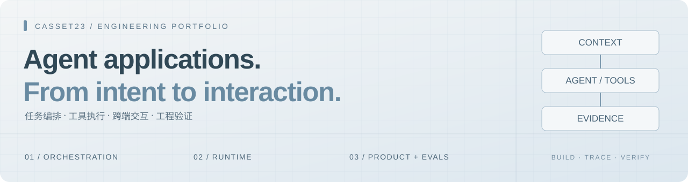

# casset23 · Agent Applications & Backend Engineering

以后端开发为主，连接 Agent 的任务编排、工具执行、会话状态与 Web / 桌面交互。实践覆盖智能客服、Coding Agent Runtime、多模态质检和文档问答，关注功能怎样从需求走到可运行、可检查的交付。

**代表作品：[ServicePilot Agent · 智能客服](https://github.com/casset23/servicepilot-agent)**  
从意图路由、业务工具编排和补问恢复，看 Agent 如何与前端交互衔接；从测试与一次修复记录，看实现如何被检查。

[代表作品](#代表作品servicepilot-agent) · [Agent 协作开发](#使用-agent-完成的一次迭代) · [实习实践](#实习中的工程实践) · [其他作品](#其他作品) · [技术栈](#技术栈)

## 代表作品：ServicePilot Agent

**把一次客户提问组织成可路由、可补问、可调用工具的处理过程。**

商品介绍、订单查询和售后咨询需要不同的处理路径。ServicePilot 以 LangGraph 状态图组织意图分类、补充询问、业务查询与结果汇总，FastAPI 提供流式接口，Vue 客服面板承接输入与回答。

| 环节 | 实现与工程重点 |
| :--- | :--- |
| **意图与任务编排** | 将通用咨询、补充询问、业务查询和图片入口分开；复杂查询进入业务子图，经过范围判断、任务规划与工具选择，通过 `Send` 分发子任务。 |
| **业务工具接入** | 按任务选择 Text2Cypher、预定义查询与售后知识检索，使用 Pydantic Schema 描述参数，工具结果交给汇总节点。 |
| **补问与状态续接** | `conversation_id` 对应图运行线程；MemorySaver 保存上下文，`interrupt` 等待客户补充信息，`Command(resume=...)` 将回复带回执行流程。 |
| **前后端交互** | FastAPI 通过 SSE 发送文本和中断元数据；Vue 面板根据会话状态切换首次请求与恢复请求，解析器缓存完整事件后再处理 JSON。 |

**几个具体的判断：**

- **把“生成补问”和“等待回复”拆成两个节点。** 恢复执行时进入等待节点，避免为了接收客户回复而重复调用生成补问的模型。
- **把流式协议当作前后端共同维护的接口。** 一次网络读取可能只有半段 JSON，也可能把一个中文字符的字节拆开；使用流式解码与事件缓冲，统一首次请求和恢复请求的中断通知与结束标记。
- **把配置放回实际的运行上下文。** 图片路径从 `RunnableConfig` 读取，并用真实状态图检查配置是否传到了路由函数。

`Python` `LangGraph` `FastAPI` `Pydantic` `Neo4j` `Vue 3` `TypeScript`

[架构与调用链](https://github.com/casset23/servicepilot-agent#agent-如何处理请求) · [界面与快速开始](https://github.com/casset23/servicepilot-agent#快速开始) · [流式协议](https://github.com/casset23/servicepilot-agent#流式输出与会话恢复) · [测试与构建](https://github.com/casset23/servicepilot-agent#测试与构建)

查看客服界面

## 使用 Agent 完成的一次迭代

我使用 Codex 辅助源码阅读、修改、测试与审查。以 ServicePilot 的一次迭代为例，任务是让客户补充信息后能够继续对话，并让聊天面板正确处理流式响应。

| 阶段 | 如何组织工作 | 留下的检查依据 |
| :--- | :--- | :--- |
| **拆解任务** | 将问题拆成图状态、HTTP 流式接口、前端解析与交互、回归验证四部分，分别定位入口，再检查它们之间的接线。 | 状态定义、查询与恢复接口、客服面板和 SSE 解析器。 |
| **提供上下文** | 结合现有状态图、接口参数与前端调用方式修改；把会话标识、中断元数据和结束标记作为共同接口约束。 | 同一线程中的请求与恢复流程，以及前后端使用的数据结构。 |
| **审查与纠错** | 通过审阅和测试定位“有恢复接口却没有实际中断”“图片配置没有进入路由”“恢复流缺少中断通知”等问题，逐项修复。 | 独立等待节点、统一流式输出、运行配置路由检查。 |
| **验证交付** | 使用真实 LangGraph 和检查点测试中断与恢复，模型节点用桩函数隔离；用逐字节拆分检查 SSE，再执行前端类型检查和生产构建。 | 该次迭代的 11 项 Python 检查、4 项 Node 协议测试，以及构建与 CI 记录。 |

这次迭代把“存在接口”进一步落实到状态流转和协议行为：客户回复进入原线程，前端识别中断状态，首次请求与恢复请求共用事件输出。

[状态图恢复测试](https://github.com/casset23/servicepilot-agent/blob/main/tests/test_customer_resume.py) · [SSE 测试](https://github.com/casset23/servicepilot-agent/blob/main/tests/sse.test.mjs) · [前端解析器](https://github.com/casset23/servicepilot-agent/blob/main/frontend/src/utils/sse.ts) · [CI 记录](https://github.com/casset23/servicepilot-agent/actions)

## 实习中的工程实践

### 多模态质检 Agent：任务、记忆与取证

负责 AI 成片质检 Agent 的方案设计与工程实现，将检查项编排、镜头圈选、多模态取证和逐镜头报告串起来。

- **任务组织：** Planner 将提示词和质检模板编译成子任务队列，ReAct 控制器根据工具结果推进取证；通过采帧粗筛可疑区间，再结合高分辨率帧和音频检查细节。
- **记忆与预算：** 以焦点缓存、实体档案、证据台账保留跨镜头信息；每轮工具调用后整理上下文，使用步数预算、上下文清理与增强复检路由控制多轮执行。
- **服务与反馈：** 通过 FastAPI、Celery 和 Redis 承接异步任务，持久化诊断结果并推送报告状态；用金标评测、消融实验和 badcase 回流检查机制的作用。

### Coding Agent Runtime：上下文与扩展状态治理

负责上下文感知的提示词增强功能端到端设计与实现，参与 Runtime 稳定性、Skill 分发和 MCP 生命周期治理。

- **提示词增强：** 结合会话摘要、近期历史、Skill 与附件元数据补全短指令，通过上下文隔离、输出校验与用户确认约束增强结果，并用开发任务及注入攻击样本评测。
- **长任务稳定性：** 参与新增 Tool Result 的预算处理，保留预览与恢复线索，保持已见结果稳定重放；完善滚动摘要、持续超限退出和连续压缩次数上限。
- **跨会话一致性：** 通过定向缓存失效与 SSE 刷新同步技能变更；将 MCP 配置变化定位到单个 Server，完善连接失败、替换和实例销毁时的资源释放与旧工具清理。

### 企业多模态 RAG：重排、引证与评测

负责召回后链路的设计与实现，围绕相似页面干扰、证据选择和出处可核验的问题展开优化。

- **候选页整理：** 按文档归族，挖掘同族相邻页作为难负样本，提高重排时对相似页面的区分度。
- **引证式作答：** 设计页面重排与引证生成两阶段 GRPO / LoRA 方案，以格式、引证与作答奖励约束输出，并结合结构化解析、引证校验和降级策略。
- **训练与验证：** 使用 vLLM 采样与训练解耦，治理训练子集，结合公开基准、内部端到端评测和引证可信度检查比较方案。

## 其他作品

### [Voice Agent Runtime](https://github.com/casset23/voice-agent-runtime) · 模型与工具服务后端

Rust Gateway → Python LLM Runner → Tool Service 构成指令执行链路，NestJS / SQLite 资源中心管理模型与工具，React 管理台承接配置交互。

- Gateway 处理 Request ID、请求占用保护、下游超时和结果聚合。
- Runner 解析 Function Calling，管理 HTTP 客户端复用、空闲回收与显式配置刷新。
- 管理台与资源中心分离配置维护和运行时读取接口，支持沿单条请求追踪模块职责。

**适合查看：** 多服务调用链、连接生命周期与配置治理。  
[服务架构](https://github.com/casset23/voice-agent-runtime#服务架构) · [生命周期设计](https://github.com/casset23/voice-agent-runtime#模型配置与连接生命周期) · [测试与验证](https://github.com/casset23/voice-agent-runtime#测试与验证)

### [AssistGen](https://github.com/casset23/assistgen) · 文档问答应用

围绕教材和技术资料组织文档清洗、章节分块、检索与引证生成，应用层提供聊天、会话和知识库交互。提供直接读取 Markdown 的分块示例，便于检查目录过滤、章节边界、正文保留与分块配置。

**适合查看：** 文档处理的分层设计、可复现示例与规则回归。  
[轻量复现](https://github.com/casset23/assistgen#先复现文档分块) · [RAG 链路](https://github.com/casset23/assistgen#rag-链路与设计取舍) · [验证与评测](https://github.com/casset23/assistgen#验证与评测)

### [超声报告桌面助手](https://github.com/casset23/ultrasonic-agent) · LLM 驱动的桌面工作流

连接口述、模板、结构化草稿、人工审核和 Windows 桌面填写。流程由应用组织，模型承担内容整理，Electron IPC 衔接界面与桌面能力，SQLite 保存模板。

- 固定 JSON 结果结构，将字段、缺失项与警告一起交给审核界面。
- 区分内容输入与操作口令，对否定表达和叙述性语句增加误触发防护。
- 将规则预览、外部服务和模拟窗口分层检查，便于定位联调问题。

**适合查看：** 桌面交互、人工确认、信息保真与系统自动化。  
[操作流程](https://github.com/casset23/ultrasonic-agent#界面与使用流程) · [工程取舍](https://github.com/casset23/ultrasonic-agent#几个具体的工程取舍) · [测试与验证](https://github.com/casset23/ultrasonic-agent#测试与验证)

## 开发与验证方式

| 关注点 | 具体做法 |
| :--- | :--- |
| **需求与验收** | 把输入、输出、状态变化、失败路径和确认动作写清楚，优先打通一条可以运行和检查的用户流程。 |
| **模块与协作** | 按前端交互、服务接口、模型与工具、数据状态划分职责；通过参数与事件约束衔接，沿调用链定位问题。 |
| **Agent 辅助开发** | 给出相关源码和明确任务，让 Agent 分步修改；结合差异审阅、协议测试和构建检查判断结果。 |
| **效果与稳定性** | 区分模型效果、协议行为和系统运行问题，分别使用评测样本、回归测试、日志和失败场景验证。 |

## 技术栈

| 层次 | 主要技术 |
| :--- | :--- |
| Agent 与交互 | LangGraph、ReAct、Tool Use、MCP、Skill、Memory、SSE、Vue、React、Electron |
| 后端与数据 | Python、FastAPI、TypeScript、Node.js、Java、Spring Boot、Rust、MySQL、Redis、SQLite |
| 模型与检索 | Prompt Enhancement、多模态取证、文档解析、FAISS、重排、GRPO、LoRA、vLLM |
| 工程与评测 | Git、Docker、异步任务、超时与资源回收、回归测试、LLM-as-a-Judge、消融实验 |

---

从 [ServicePilot 的架构与运行步骤](https://github.com/casset23/servicepilot-agent)开始了解应用，或沿[一次 Agent 协作迭代](#使用-agent-完成的一次迭代)查看问题定位与验证过程。

casset23 · Agent applications, backend systems & interaction · Updated 2026-11-11

<!-- Maintainer: casset23. Review on project releases, changes in role, or changes in resume claims. -->
