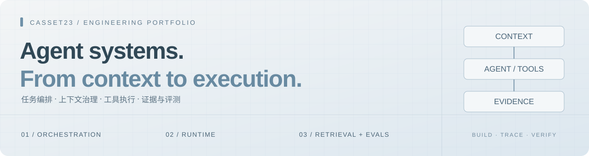

<b>Agent 后端开发 · 文档智能 · 运行时可靠性</b>

把模型能力放进可运行、可检查、可持续改进的系统。

---

### 关于我

关注 Agent 应用后端、文档问答和运行时可靠性。经历覆盖模型与工具接入、上下文和状态管理、文档检索，以及离线评测。喜欢沿着完整调用链理解问题，再用测试和可复现示例说明实现边界。

项目覆盖桌面工作流、文档检索与智能音箱后端，提供架构说明、运行示例和回归测试，便于沿着完整调用链阅读实现。

### 精选项目

| 项目 | 做什么 | 建议先看 |
| :--- | :--- | :--- |
| **[Ultrasonic Agent](https://github.com/casset23/ultrasonic-agent)** | 口述 → 模板 → 结构化报告草稿 → 人工审核 → 桌面填写 | Electron IPC、JSON 输出检查、SQLite 模板入库、Windows 自动化 |
| **[AssistGen](https://github.com/casset23/assistgen)** | 文档清洗分块、检索组织与引证问答探索 | 可独立运行的 Markdown 分块示例、检索配置和评测脚本 |
| **[Voice Agent Runtime](https://github.com/casset23/voice-agent-runtime)** | 智能音箱 Agent 后端：意图解析、工具调用与资源配置 | Rust Gateway、Python LLM Runner、NestJS/SQLite 资源中心与 React 管理台 |

### 我关注的工程问题

**Agent 与 Runtime**　任务编排 · Tool Use · MCP / Skill · 上下文预算 · 生命周期管理  
**文档与证据**　解析和分块 · 混合检索 · 候选重排 · 引证作答 · 离线评测  
**后端实现**　Python / FastAPI · TypeScript / Node.js · Java / Spring Boot · MySQL · Redis  
**工程方法**　接口契约 · 回归测试 · 错误恢复 · 可追溯日志 · Docker

### 当前在完善

- 为个人项目补充小型、可复现的评测与失败场景。
- 将应用原型中的配置、运行步骤和模块边界整理清楚。
- 完善模型接入、工具执行和数据访问的边界检查。

---

Build a small complete path. Verify it. Then improve it.

